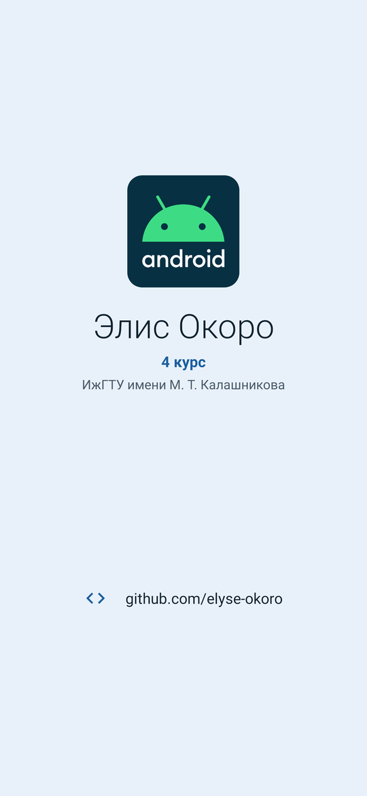
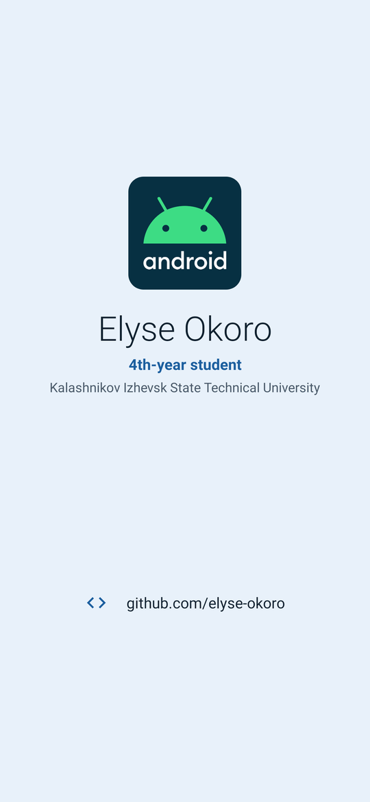
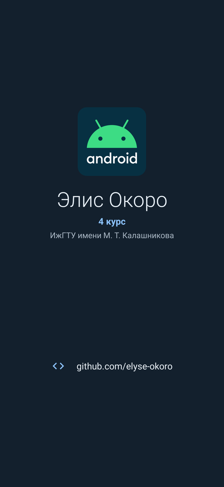
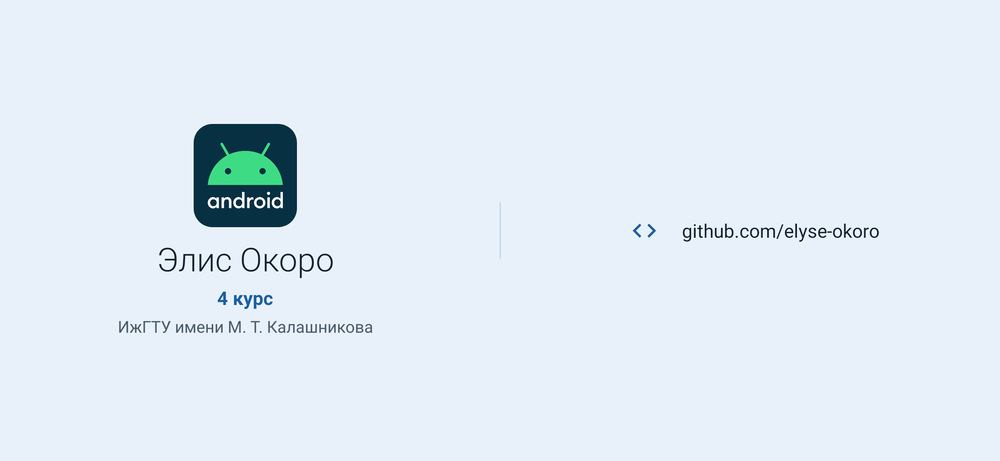
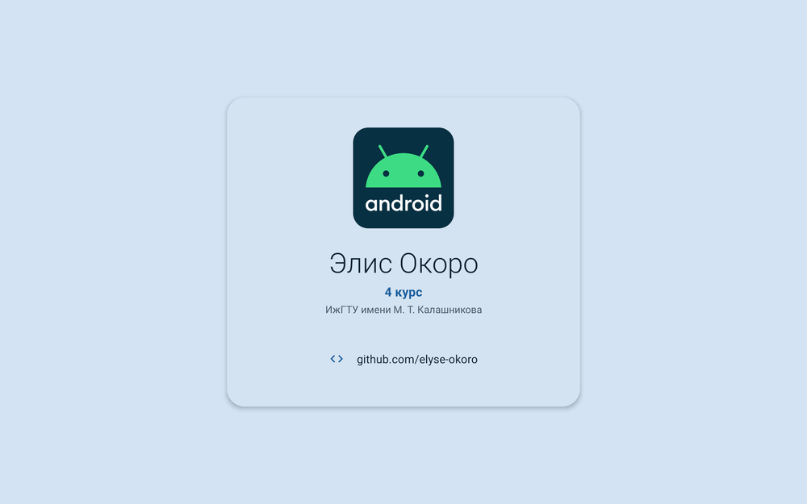

# Визитка

Лабораторная работа № 1 «Визитка»: приложение из одного экрана с визитной карточкой студента. Разметка на XML.

## Что на экране

- Логотип Android, имя и фамилия, курс и вуз.
- Контакт — профиль на GitHub. По нажатию он открывается в браузере неявным интентом `ACTION_VIEW`; если открыть нечем, появляется сообщение.

## Как сделано

- Все тексты лежат в `strings.xml`: английский по умолчанию в `values`, переводы в `values-en` и `values-ru`. Цвета — в `colors.xml`, отступы и размеры шрифтов — в `dimens.xml`.
- Портретная ориентация — `layout/activity_main.xml`. В альбомной (`layout-land`) визитка делится на две колонки: слева профиль, справа контакты.
- На планшете (`layout-sw600dp`) визитка — карточка по центру экрана, размеры для неё заданы в `values-sw600dp`.
- Содержимое не заходит под строку состояния, вырез камеры и панель навигации: отступы берутся из `WindowInsets`. На маленьком экране визитка прокручивается.
- Профиль и контакты вынесены в `view_profile.xml` и `view_contacts.xml` и подключаются через `include`, поэтому три разметки экрана не повторяют друг друга.
- Тёмная тема: цвета в `values-night`.

## Запуск

Открыть папку проекта в Android Studio и запустить конфигурацию `app` (minSdk 24, targetSdk 36).

## Экраны

| Портрет | English | Тёмная тема |
|---|---|---|
|  |  |  |

Альбомная ориентация:

Планшет:

